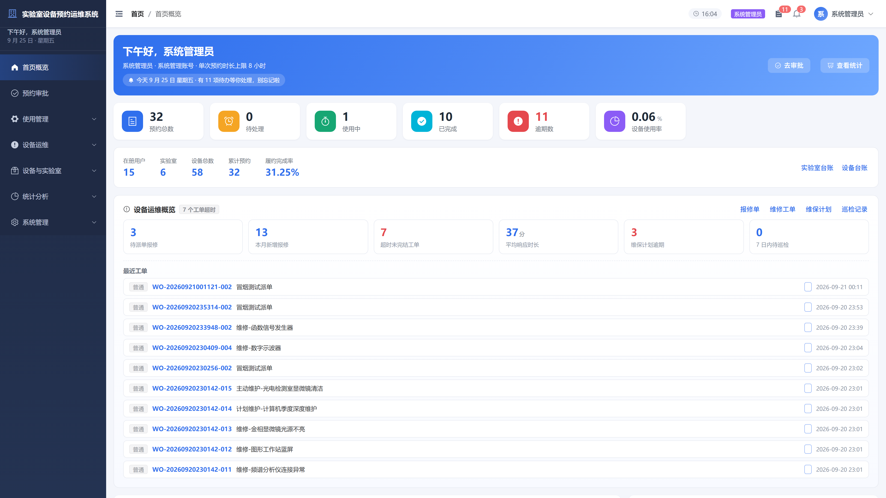
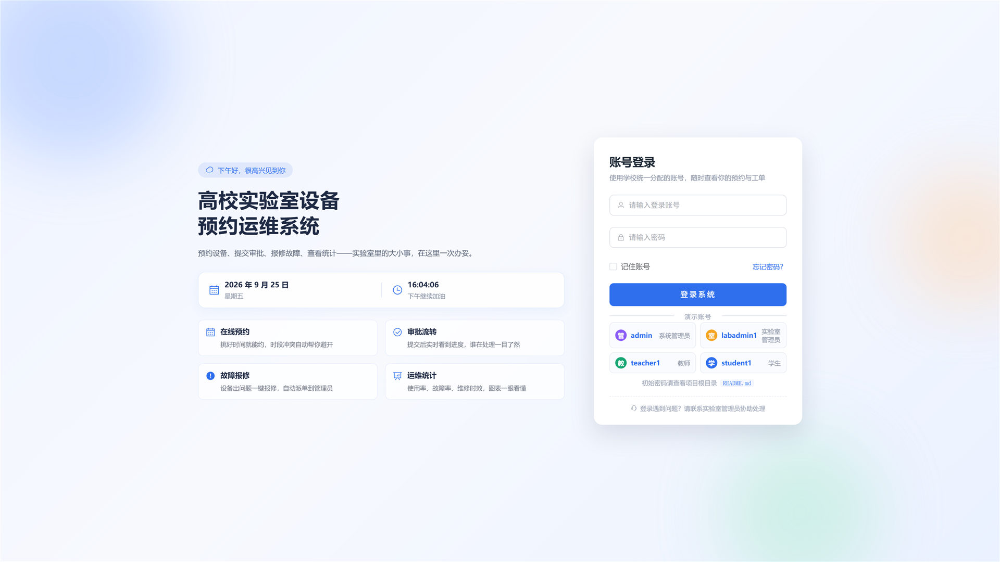

# 高校实验室设备预约运维系统

> 本科毕业设计 —— 全栈 Web 应用，覆盖设备预约、审批流转、故障报修、维修工单、维保巡检与统计分析全流程。





---

## 一、选题背景与意义

高校实验室承担着教学、科研与社会服务的重要职能。随着高校"双一流"建设推进和"新工科"教育改革深化，实验室设备的数量与精密程度持续增长，传统的"纸质登记 + 微信群沟通"模式已难以满足：

- **设备调度效率低**：人工排班冲突频发，预约变更无法追溯；
- **运维成本居高不下**：故障报修响应慢，缺少预防性维护，设备带病运行；
- **数据资产沉睡**：使用记录、故障数据无法支撑资产决策；
- **师生体验欠佳**：审批黑盒、消息触达不及时。

本系统面向**学生、教师、实验室管理员、系统管理员**四类角色，以"预约驱动使用、运维保障寿命、统计辅助决策"为主线，构建覆盖实验室设备全生命周期的一体化平台。

---

## 二、技术栈

| 类别 | 选型 | 版本 | 说明 |
|------|------|------|------|
| 前端框架 | Vue 3 | 3.x | 组合式 API + `<script setup>` |
| 构建工具 | Vite | 5.x | 极速 HMR + 生产构建 |
| UI 组件 | Element Plus | 2.x | 中后台事实标准 |
| 状态管理 | Pinia | 2.x | Vue 3 官方推荐 |
| 路由 | Vue Router | 4.x | 路由级权限 + 动态菜单 |
| HTTP | Axios | 1.x | 请求/响应拦截 + 自动重试 |
| 图表 | ECharts | 5.x | 趋势 / 分布 / 排行可视化 |
| 后端框架 | Django + DRF | 4.2 / 3.14 | 成熟稳定，文档完善 |
| 数据库 | MySQL | 8.0 | 关系型，事务强一致 |
| 鉴权 | SimpleJWT | 5.x | 无状态 Token，刷新机制 |
| 实时通信 | WebSocket (Channels 兼容) | — | 站内通知 / 聊天 |
| 部署 | Nginx + Gunicorn / Daphne | — | 反向代理 + WSGI/ASGI |

---

## 三、系统功能

### 3.1 角色与权限

| 角色 | 关键能力 |
|------|----------|
| 系统管理员 | 全部模块、用户/学院/班级管理、参数配置、跨实验室统计 |
| 实验室管理员 | 本实验室设备/预约审批、维修工单、维保计划、巡检 |
| 教师 | 预约审批（本实验室）、故障报修、使用统计 |
| 学生 | 设备预约、故障报修、个人中心 |

### 3.2 功能模块

```
┌─ 预约管理 ──────────────┐  ┌─ 使用管理 ──────────────┐
│  设备预约               │  │  签到 / 签退           │
│  预约审批（通过/驳回）  │  │  进度跟踪               │
│  转派 / 撤回            │  │  使用评价               │
└─────────────────────────┘  └─────────────────────────┘
┌─ 设备与实验室 ──────────┐  ┌─ 设备运维 ──────────────┐  ┌─ 统计分析 ──────────────┐
│  实验室台账             │  │  故障报修（本设计新增）  │  │  使用率 / 趋势          │
│  设备台账               │  │  维修工单全流程         │  │  故障率 / 维修时效      │
│  学院 / 班级管理        │  │  维保计划（周期性）     │  │  申请人排行 / 导出      │
│  设备分类               │  │  巡检记录               │  │  资产总览               │
└─────────────────────────┘  └─────────────────────────┘  └─────────────────────────┘
┌─ 通知与沟通 ────────────┐  ┌─ 系统管理 ──────────────┐
│  站内通知（批量已读）   │  │  用户管理               │
│  预约沟通 / 评价回复    │  │  操作日志               │
└─────────────────────────┘  └─────────────────────────┘
```

### 3.3 设备运维（本设计的核心扩展）

> 区别于市面上仅做"预约"的管理系统，本设计增加了完整的**运维子模块**，将"故障报修 → 维修工单 → 维保计划 → 巡检记录"串成闭环：

- **故障报修**：学生 / 教师一键报修，触发设备进入"维修中"状态
- **维修工单**：派单 → 开始 → 完成（含方案、配件、费用）→ 验收
- **维保计划**：按周/月/季/年配置周期与检查清单，自动推送逾期提醒
- **巡检记录**：执行巡检，结果为"需维修"时自动派生工单

---

## 四、项目结构

```
lab-ops/
├── backend/                    # Django 后端
│   ├── apps/
│   │   ├── accounts/           # 用户、学院、班级
│   │   ├── labs/               # 实验室、设备、分类
│   │   ├── reservations/       # 预约、审批、签到、评价
│   │   ├── notifications/      # 站内通知、邮件提醒
│   │   ├── auditlog/           # 操作审计
│   │   ├── statistics/         # 统计分析
│   │   └── maintenance/        # 【本设计】设备运维
│   │       ├── models.py       # 4 张核心表
│   │       ├── views.py        # 状态机 + 工单生命周期
│   │       └── management/commands/seed_maintenance_demo.py
│   ├── labsys/                 # 工程配置
│   ├── scripts/smoke_test.py   # 104 项接口冒烟测试
│   └── manage.py
│
├── frontend/                   # Vue 3 前端
│   ├── src/
│   │   ├── api/index.js        # 接口封装（含 22 个运维接口）
│   │   ├── views/
│   │   │   ├── maintenance/    # 【本设计】4 个新页面
│   │   │   │   ├── FaultReport.vue       故障报修
│   │   │   │   ├── OrderList.vue         维修工单
│   │   │   │   ├── PlanList.vue          维保计划
│   │   │   │   └── InspectionList.vue    巡检记录
│   │   │   └── ...             # 预约、设备、统计等
│   │   ├── layouts/MainLayout.vue
│   │   └── stores/             # Pinia
│   ├── package.json
│   └── vite.config.ts
│
├── docs/                       # 毕业设计文档
│   ├── 01-系统设计.md
│   ├── 02-数据库设计.md
│   ├── 03-API文档.md
│   ├── 04-部署文档.md
│   ├── 05-用户手册.md
│   └── 06-测试报告.md
│
└── README.md
```

---

## 五、快速开始

### 5.1 环境准备

- Python 3.10+
- Node.js 20+
- MySQL 8.0（或 SQLite 3，本地开发可降级）

### 5.2 后端

```bash
cd backend
pip install -r requirements.txt
python manage.py migrate
python manage.py init_demo_data          # 基础数据
python manage.py seed_maintenance_demo   # 运维数据
python manage.py runserver 8001
```

### 5.3 前端

```bash
cd frontend
npm install
npm run dev    # http://localhost:5180
npm run build  # 生产构建
```

### 5.4 演示账号

| 角色 | 账号 | 密码 |
|------|------|------|
| 系统管理员 | `admin` | `123456` |
| 实验室管理员 | `labadmin1` | `123456` |
| 教师 | `teacher1` | `123456` |
| 学生 | `student1` | `123456` |

---

## 六、毕业设计配套文档

| 文档 | 内容 |
|------|------|
| [01-系统设计.md](docs/01-系统设计.md) | 体系架构、模块划分、技术选型理由 |
| [02-数据库设计.md](docs/02-数据库设计.md) | 28 张表的 ER 图与字段定义 |
| [03-API文档.md](docs/03-API文档.md) | 全部 REST 接口的参数与响应 |
| [04-部署文档.md](docs/04-部署文档.md) | 生产环境 Nginx + Gunicorn 部署 |
| [05-用户手册.md](docs/05-用户手册.md) | 四类角色的操作指引 |
| [06-测试报告.md](docs/06-测试报告.md) | 104 项接口冒烟测试 + 浏览器巡检 |

---

## 七、测试

```bash
# 后端接口冒烟（104 项）
cd backend && python scripts/smoke_test.py

# 前端构建 + 类型检查
cd frontend && npm run build
```

---

## 八、致谢

本设计在指导老师的悉心指导下完成，感谢实验室各位老师在需求调研阶段提出的宝贵意见。系统基于开源生态构建，向 Django、Vue、Element Plus 等优秀项目的贡献者致敬。

> © 2026 高校实验室设备预约运维系统 · 毕业设计